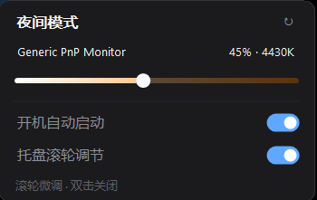

# Night light settings for Windows 🌙

**Windows 夜间模式强度调节任务栏托盘** —— Windows 10 / 11 托盘常驻的夜间模式（色温）强度调节小工具。类似 Twinkle Tray 的交互，但调的是暖色强度，并且**每台显示器记住你最后一次的设置**：重启、锁屏、休眠唤醒、拔插显示器之后自动恢复。



## 下载与安装

1. 到 [Releases](https://github.com/linglanxv/Night-light-settings-for-Windows/releases) 下载最新的 `NightTint.exe`（单文件，约 230KB，需要 .NET 8 Desktop Runtime）；
2. 放到一个固定目录（例如 `%LOCALAPPDATA%\Programs\NightTint\`）再双击运行，托盘就会出现图标；
3. 右键托盘图标 →「设置…」里打开「开机自动启动」即可常驻。

> 也可以自行编译，见文末「从源码构建」。

## 功能

- **0~100 强度滑块**（和 Windows 自带夜间模式同一个逻辑）：0 = 关闭，100 = 最暖；滑块右侧同时显示等效色温（如 `45% · 4430K`）。
- **临时开关（不退出软件）**：右键托盘菜单第一项「**启用夜间模式**」，取消勾选后屏幕立刻恢复中性白，**滑块位置全部保留**，重新勾上即原样还原；暂停时托盘图标变灰、面板滑块压暗显示「已暂停」。
- **每台显示器独立滑块**，也可用菜单对全部显示器一键设强度（0% / 25% / 50% / 75% / 100%）。
- **记忆与恢复**：按显示器记录最后一次的强度，开机 / 重新插上显示器 / 解锁 / 休眠唤醒后自动恢复；后台每 2 秒校验一次 gamma，被系统重置也会自动写回。
- **托盘常驻**：左键图标弹出面板，右键打开菜单；图标颜色实时反映状态（白 = 关闭，越橙越暖，灰 = 已暂停）。
- **独立设置面板**（滑块面板右上角 ⚙ 或右键菜单「设置…」打开）：
  - `夜间模式已启用`（总开关，同托盘菜单）
  - `开机自动启动`
  - `托盘滚轮调节`
  - `全局快捷键`
  - `启动时恢复上次强度`
- **托盘滚轮调节**：鼠标停在托盘图标上滚动滚轮，±5% 直接变暖 / 变冷。
- **全局快捷键**：`Ctrl+Alt+Shift+↑ / ↓`（避开被 Intel 核显占用的 Ctrl+Alt+↑/↓）；`Ctrl+Alt+B` 弹出 / 收起面板。
- **命令行控制**（对正在运行的实例生效，可做成快捷方式 / 脚本 / Stream Deck 按钮）：

  ```text
  NightTint.exe --show      弹出面板
  NightTint.exe --settings  打开设置
  NightTint.exe --on        启用夜间模式
  NightTint.exe --off       临时暂停（保留滑块位置）
  NightTint.exe --toggle    在启用 / 暂停之间切换
  ```

- **轻量**：.NET 8 原生 WinForms，单文件约 230KB，无 Electron，启动不到 1 秒。
- 退出程序时自动把屏幕恢复成中性白，不会把暖色留在系统里。

## 实现原理

色温走 GDI **Gamma Ramp**（`SetDeviceGammaRamp`，f.lux / Redshift 同款方案）：

1. 强度 0~100 → 开尔文色温（0 = 6500K 原生白点，100 = 1900K 极暖）；
2. 开尔文 → RGB 系数（黑体辐射近似，Tanner Helland 算法），归一化到最亮通道避免整体变暗；
3. 每台显示器一个 GDI DC（`\\.\DISPLAY1` …），写入 3×256 gamma ramp；
4. 后台线程每 2 秒读回当前 ramp 校验，发现被重置（锁屏、驱动重置、分辨率切换）立即写回 —— 这是"记住并保持"的关键。

「临时开关」的实现：暂停时把目标色温统一下发为 6500K 中性白，**不动记忆里的强度值**，所以恢复时原样还原。单实例之间用命名管道通信，`--off` 这类命令发给已在托盘运行的实例。

不需要管理员权限，不需要 DDC/CI，笔记本内屏和外接显示器都适用。

## 使用

| 操作 | 说明 |
| --- | --- |
| 左键托盘图标 | 弹出 / 收起面板 |
| 右键托盘图标 | 菜单（**启用夜间模式**、预设强度、开机自启、设置、退出等） |
| 拖动滑块 | 实时调节，松手即记忆 |
| **双击滑块行** | 关闭夜间模式（0%） |
| 面板右上角 ⚙ / 右键菜单「设置…」 | 打开设置面板（总开关、开机自启动、滚轮、快捷键、启动恢复） |
| 托盘上滚轮 | ±5% 快速微调 |
| `Ctrl+Alt+Shift+↑/↓` | 全局调整强度 |
| `Ctrl+Alt+B` | 全局弹出面板 |
| `--on / --off / --toggle` | 命令行临时开关（保留记忆） |

配置文件：`%LOCALAPPDATA%\NightTint\settings.json`（每台显示器的强度、暂停状态都记在这里）。

## 从源码构建

需要 [.NET 8 SDK](https://dotnet.microsoft.com/download/dotnet/8.0)。

```bash
# 调试运行
dotnet run --project src/NightTint -c Release

# 发布单文件（约 230KB）
dotnet publish src/NightTint -c Release -r win-x64 --self-contained false -p:PublishSingleFile=true -o publish

# 直接弹出面板 / 设置面板 / 临时开关（可做成快捷方式）
NightTint.exe --show
NightTint.exe --settings
NightTint.exe --toggle
```

> 发布产物依赖已安装的 .NET 8 Desktop Runtime；想要完全绿色版把 `--self-contained false` 改成 `true`（体积约 150MB）。

### 没有 SDK 时的用户级安装（不需要管理员）

```powershell
Invoke-RestMethod https://dot.net/v1/dotnet-install.ps1 -OutFile dotnet-install.ps1
./dotnet-install.ps1 -Channel 8.0 -InstallDir "$env:USERPROFILE\.dotnet8"
$env:PATH = "$env:USERPROFILE\.dotnet8;$env:PATH"
```

## GitHub Actions 自动构建

仓库里带了 [.github/workflows/build.yml](.github/workflows/build.yml)：

- 每次推送到 `main` 自动构建，产物在 Actions 的 Artifacts 下载；
- 推送 `v*` 标签（如 `v1.1.0`）自动创建 Release 并附上 `NightTint.exe`。

```bash
git clone https://github.com/linglanxv/Night-light-settings-for-Windows.git
```

## 已知限制

- **和系统自带夜间模式互斥**：两者都改 gamma 会互相覆盖，请关闭 Windows 夜间模式后使用本软件。
- **HDR 模式无效**：显示器开启 HDR 时 GDI gamma 不生效，请关闭 HDR 或改用显示器 OSD。
- 使用 ICC 颜色配置文件校色过的屏幕，gamma 可能被校准约束，效果会打折。
- 个别老旧驱动对 ramp 有量化误差，程序已做 ±2% 容错。

## Roadmap

- [ ] 按时间自动切换（日落变暖 / 日出恢复）
- [ ] 多显示器配置导出 / 导入
- [ ] 可自定义快捷键与步长

## License

MIT
